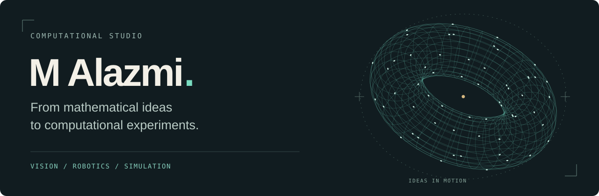
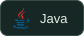
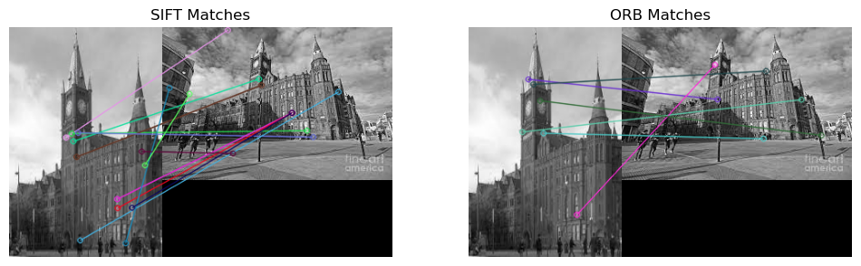
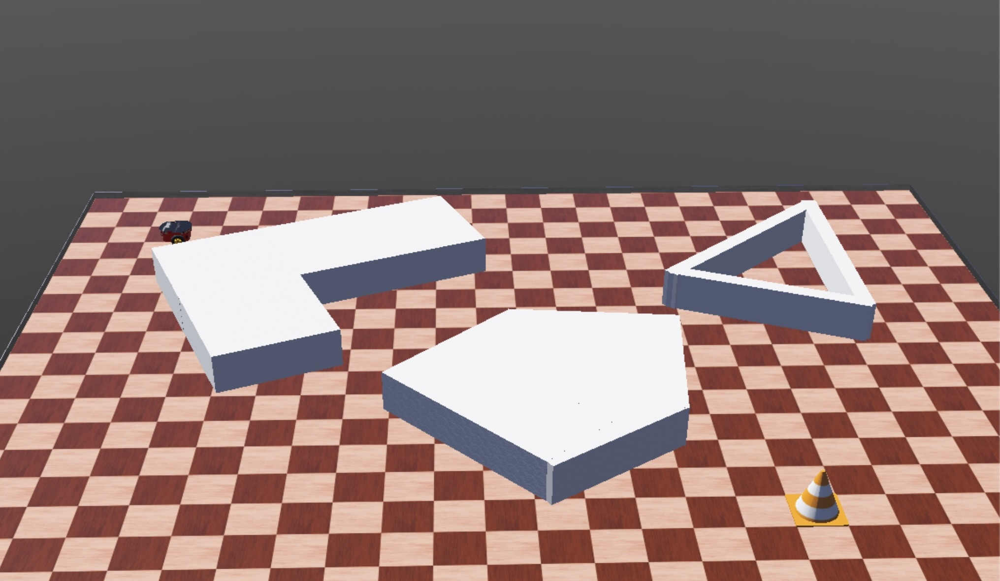
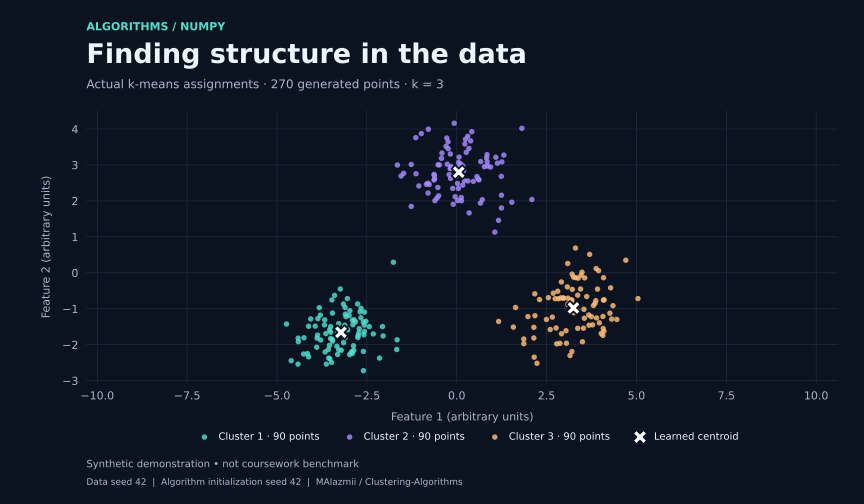
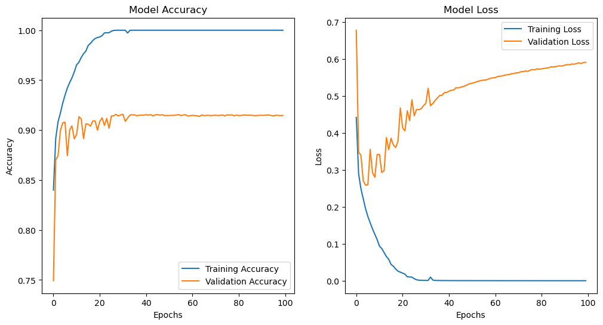

<picture>
  <source media="(prefers-reduced-motion: reduce)" srcset="assets/studio-header-static.svg">
  
</picture>

### Hi, I'm M Alazmi.

I explore **machine learning, computer vision, and simulation** through code. I'm interested in the connection between mathematical ideas and systems we can see in action: recognizing patterns, navigating obstacles, and modelling how signals travel.

This is my collection of coursework, experiments, and prototypes—with the methods, outputs, and reproduction notes alongside the code.

**[Explore the projects ↓](#selected-projects)** &nbsp; · &nbsp; [Browse all repositories](https://github.com/MAlazmii?tab=repositories)

  
  
  
  
  
  
  
  

## Selected projects

<table>
<tr><td>
01 / COMPUTER VISION
<h3><a href="https://github.com/MAlazmii/2D-Convolution-SIFT-FeatureMatching">From pixels to correspondences</a></h3>

Custom image filters, ORB keypoints, and SIFT/ORB matching: exploring how local image structure becomes a set of correspondences.

<b>Python · OpenCV · NumPy</b>

<a href="https://github.com/MAlazmii/2D-Convolution-SIFT-FeatureMatching">Notebooks &amp; visual results →</a>

Original saved notebook output

</td></tr>
</table>

<table>
<tr><td>
02 / ROBOTICS
<h3><a href="https://github.com/MAlazmii/roboticSimulationDevelopedIn-Webots">Finding a way through</a></h3>

A Pioneer 3-DX connects sonar readings to movement through goal seeking and wall following, built on a laboratory teaching scaffold.

<b>Java · Webots · Reactive control</b>

<a href="https://github.com/MAlazmii/roboticSimulationDevelopedIn-Webots">Controller &amp; setup →</a>

Original project screenshot

</td></tr>
</table>

<table>
<tr><td>
03 / MACHINE LEARNING
<h3><a href="https://github.com/MAlazmii/Clustering-Algorithms">Discovering structure in data</a></h3>

NumPy implementations of k-means, k-means++ initialization, and bisecting k-means, with silhouette evaluation and synthetic-data experiments.

<b>Python · NumPy · Unsupervised learning</b>

<a href="https://github.com/MAlazmii/Clustering-Algorithms">Algorithms &amp; experiments →</a>

Synthetic demonstration using the repository's k-means implementation

</td></tr>
</table>

## Also in the lab

**[Image classification with a CNN](https://github.com/MAlazmii/ImageClassificationWithCNN_)** — a TensorFlow/Keras study in grayscale image recognition, with training curves and saved evaluation outputs.

See the recorded learning curves

Historical notebook output, not a new training run. [Read the experiment's scope and limitations](https://github.com/MAlazmii/ImageClassificationWithCNN_).

- **[Brain signal simulation](https://github.com/MAlazmii/brain_pdp)** — a C serial baseline and experimental MPI work for signal propagation through neuron-and-nerve graphs.
- **[Sales prediction prototype](https://github.com/MAlazmii/Walmart-Sales-prediction-project)** — a Flask interface connecting model inference to CSV-backed inventory charts.
- **[Geometric GUI](https://github.com/MAlazmii/GUI-Application)** — a small C# application for drawing lines and finding their intersections.

## Apps and algorithms

- **[Campus and mural map](https://github.com/MAlazmii/UOL_Map)** — a Swift coursework app exploring maps, location, and saved favourites.
- **[Wheel of Fortune](https://github.com/MAlazmii/Swift-WheelofFortune)** — a UIKit word game with phrase categories and scoring.
- **[Data cleaning](https://github.com/MAlazmii/Data_Processing)** — a JavaScript exercise in validating and normalizing CSV records.
- **[Square grouping](https://github.com/MAlazmii/Square-Grouping-problem)** — dynamic programming for partitioning a sequence into consecutive groups.

## Programming foundations

Coursework and smaller exercises are grouped by language, with original source credits and setup notes in each collection.

[Java](https://github.com/MAlazmii/java-programming) · [C](https://github.com/MAlazmii/c-programming) · [Haskell](https://github.com/MAlazmii/haskell-programming) · [Web fundamentals](https://github.com/MAlazmii/web-fundamentals) · [Swift examples](https://github.com/MAlazmii/swift_laps)

---

<b>Perception. Behavior. Computation.</b> Different projects, connected by curiosity about how systems work.

<a href="ARTWORK.md">Artwork &amp; image credits</a> · Animation respects reduced-motion preferences

